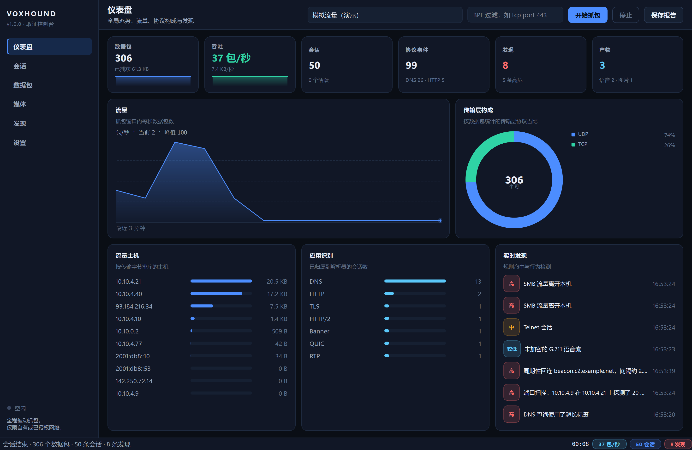
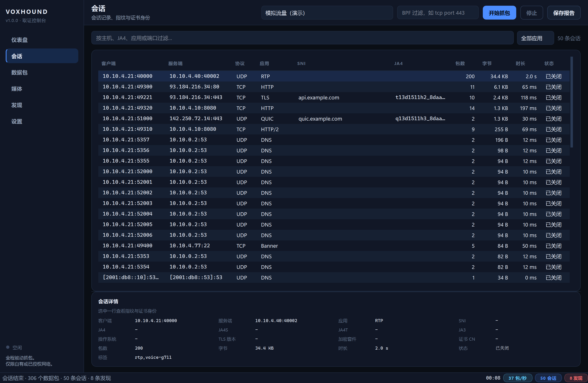
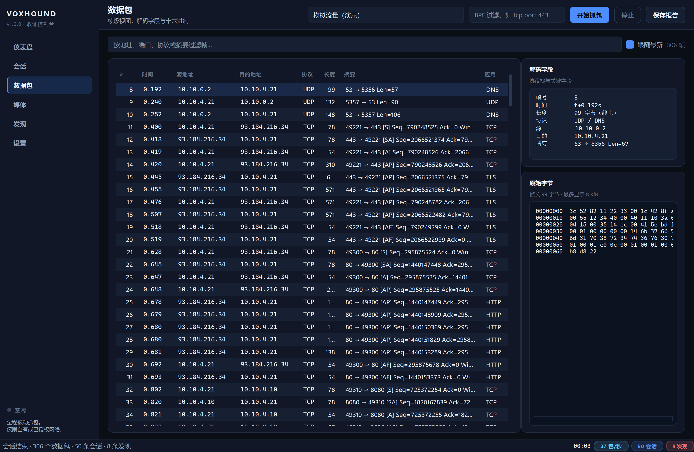
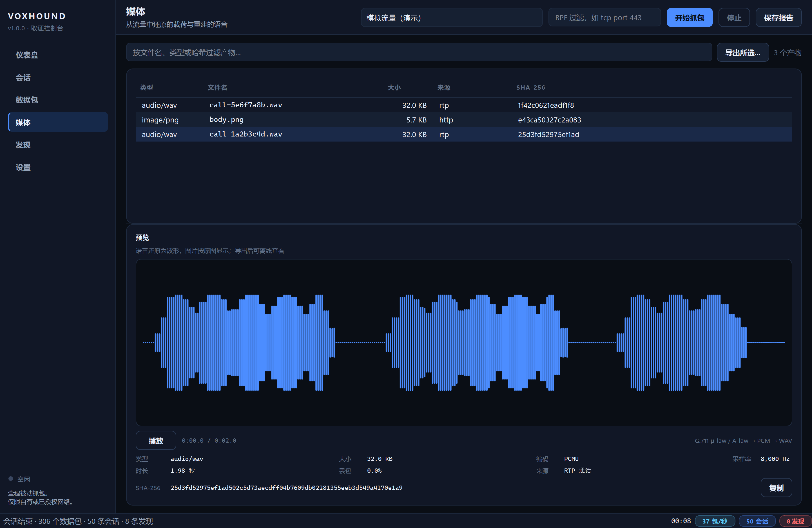
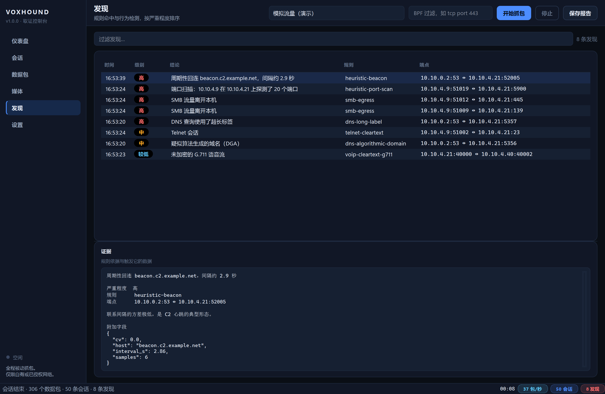
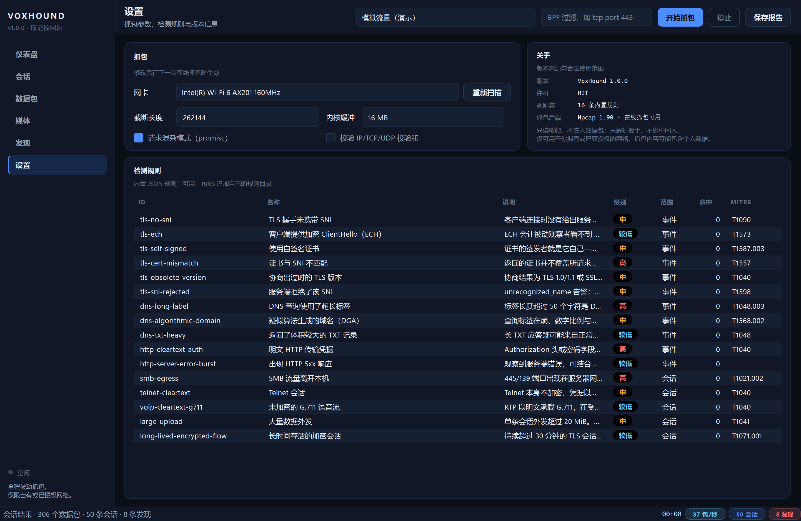
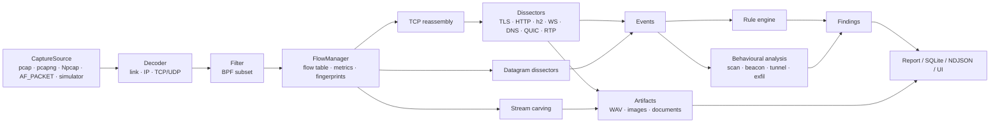

# VoxHound

Passive network forensics for voice and media traffic. The input is a capture file or a live interface; the output is a flow table, protocol fingerprints, an asset list and findings.

Chinese is the primary language: [`README.md`](README.md). This file and `docs/*.en.md` are English counterparts and can lag behind.

[](.github/workflows/ci.yml)
[](LICENSE)
[](pyproject.toml)
[](#why-a-zero-dependency-engine)



## What it is

VoxHound reads packets, reconstructs conversations, and answers the questions an analyst actually asks:

- Who is talking, and to whom? The flow table carries SNI, ALPN, certificate identity, HTTP hosts, DNS names, JA3/JA4/JA4S/JA4T and an OS hint per endpoint.
- What is being said? RTP/RTCP streams are reassembled per SSRC and exported as playable WAV (G.711 µ-law/A-law decoded to PCM). Opus and similar codecs are exported raw with their timing metadata; claiming to decode a codec you cannot is worse than saying so.
- What is hidden in encrypted transport? QUIC Initial packets are decrypted with the RFC 9001 keys derived from the connection ID, no key material and no interception, and the TLS ClientHello inside yields the SNI and a JA4Q fingerprint.
- What should I care about? A declarative rule set plus behavioural detectors for port scans, beaconing, DNS tunnelling and exfiltration, with evidence attached to every finding.

Output goes to a single HTML report, a SQLite database, NDJSON, CSV, filtered pcap, or straight to the desktop UI.

| | |
|---|---|
|  |  |
| Flows: conversations, fingerprints, certificate identity | Packets: frame list, decoded fields, hex |
|  |  |
| Media: carved payloads, reconstructed voice | Findings: rules and behavioural detections |
|  | |
| Settings: capture options, detection rules, legal scope | |

## Why a zero-dependency engine

`pip install voxhound` pulls nothing. No Scapy, no dpkt, no cryptography, no pyshark; the engine imports only the standard library:

| Layer | Depends on | Why it matters |
|---|---|---|
| `capture` / `decode` / `app` / `flows` / `media` / `rules` | stdlib only | Runs in CI, in containers, on air-gapped hosts, on a bare interpreter. Testable without mocks. |
| `crypto` | stdlib (pure-Python AES-GCM, HKDF) | QUIC decryption without a C dependency or an OpenSSL version lottery. |
| `ui` | `PySide6` (optional extra) | The desktop shell is the only optional part. |

The reason is operational rather than ideological. The machine that is having the incident is usually the machine where nothing can be installed, which is exactly where a forensics tool earns its place. CI enforces the constraint with an AST walk: any third-party import under `voxhound/` outside `ui/` fails the build.

## Install

```bash
git clone https://github.com/nebula-eng/voxhound.git
cd voxhound
python -m pip install -e ".[gui]"      # engine only: pip install -e .
voxhound-gui                            # or: voxhound gui
```

Live capture needs a driver; offline analysis does not.

| Platform | Requirement |
|---|---|
| Windows | [Npcap](https://npcap.com/#download) with WinPcap API-compatible Mode |
| Linux | `libpcap` (`apt install libpcap0.8`), or run with `CAP_NET_RAW` and `--raw-socket` (pure AF_PACKET, no libpcap) |
| macOS | libpcap ships with the OS |

`voxhound interfaces` tells you what is available and what to install.

## Quickstart

```bash
# 1. See it work with no privileges at all: a full simulated session
voxhound demo --report demo.html --artifacts out/

# 2. Triage a capture
voxhound analyze capture.pcapng --report report.html --store session.db --artifacts carved/

# 3. Live capture with a kernel filter, mirrored to disk
sudo voxhound sniff -i eth0 --filter "udp or tcp port 443" -w live.pcap --duration 60

# 4. Pull the TLS conversations out of a big file, then analyse only those
voxhound extract capture.pcap -o tls.pcap --filter "tcp port 443"
voxhound analyze tls.pcap --filter "tls" --report tls.html
```

Exit codes are CI-friendly: `0` clean, `1` high-severity findings, `2` critical, `3` usage or source error.

### Desktop

`voxhound-gui` opens the six-page console: dashboard, flows, packets, media, findings, settings. `Ctrl+1…6` switches pages, `Ctrl+R` starts and stops, `Ctrl+S` saves the report. The built-in simulator gives a full session on a machine with no capture driver and no traffic, which is what the demos, reviews and regressions run on.

On Windows, double-click `VoxHound.cmd` at the repository root, or drop a `.pcap/.pcapng/.cap/.gz` onto it to open and analyse that file. The launcher prefers a project-local `.venv` and otherwise scans `PATH` for the first interpreter that can import the project, so it does not depend on which Python Explorer happens to see. First run:

```bash
python -m venv .venv
.venv\Scripts\python -m pip install -e ".[gui]"
```

Equivalent command line:

```bash
python -m voxhound gui                  # open (simulator source)
python -m voxhound gui capture.pcapng   # open a file and analyse it
python -m voxhound gui iface:eth0       # preselect an interface
```

If `voxhound` or `voxhound-gui` is not found, the interpreter's `Scripts` directory is not on `PATH`; `python -m voxhound` needs no `PATH` entry.

## What is decoded

| Layer | Protocols | Notes |
|---|---|---|
| Link | Ethernet, 802.1Q/802.1ad, MPLS, PPPoE, 802.3 LLC/SNAP, Linux SLL/SLL2, BSD loopback, raw IP | stacked VLAN tags preserved |
| Network | IPv4 (options, defragmentation), IPv6 (extension chain, fragment reassembly), ARP, ICMP, ICMPv6 | optional checksum validation |
| Transport | TCP (full option parsing, out-of-order reassembly, retransmit/dup accounting, gap detection, 32-bit wraparound), UDP, SCTP/GRE/ESP pass-through | first-wins overlap policy |
| Session / app | TLS 1.2/1.3 (SNI, ALPN, versions, ciphers, certificate chain and X.509 identity, JA3/JA4/JA4S), HTTP/1.1 (chunked, pipelining, body carving), HTTP/2 (HPACK with Huffman), WebSocket, DNS (compression, EDNS, DGA scoring), QUIC (Initial decryption, JA4Q), RTP/RTCP (jitter, loss, audio), SIP/SDP, STUN, MQTT, banner protocols (SSH/FTP/SMTP/Redis/RTMP…) | dissectors chosen by content sniffing first, ports second |

Full matrix and limits: [`docs/PROTOCOLS.en.md`](docs/PROTOCOLS.en.md).

## Architecture



The engine is single-threaded and synchronous; the GUI runs it on a worker thread and marshals batches through Qt signals (48 packets or 120 ms). Memory is bounded everywhere: packet ring 20 000 rows, flow table LRU 120 000, reassembly buffer 8 MiB per direction, stream preview 64 KiB, artifact budget 256 MiB, fragment table 4 096 entries.

Details, invariants and the tricky parts: [`docs/ARCHITECTURE.en.md`](docs/ARCHITECTURE.en.md).

## Findings

16 rules ship in [`voxhound/rules/builtin.json`](voxhound/rules/builtin.json): TLS without SNI, ECH, self-signed and mismatched certificates, obsolete TLS, oversized DNS labels, DGA-shaped domains, cleartext credentials, SMB egress, unencrypted G.711, long-lived encrypted sessions and more. Adding one is a JSON object:

```json
{
  "id": "corp-dns-allowlist",
  "name": "Lookup outside the corporate resolvers",
  "severity": 2,
  "scope": "flow",
  "match": { "proto": "UDP", "port": 53, "ip_regex": "^10\\.10\\.0\\.2$" }
}
```

Rule DSL reference: [`docs/RULES.en.md`](docs/RULES.en.md).

Four behavioural detectors run alongside the rules and stay explainable:

| Detector | Signal |
|---|---|
| Port scan | one source, N distinct destination ports in a short window |
| Beaconing | coefficient of variation of contact intervals (scale-free: 5 s and 5 h implants both match) |
| DNS tunnelling | high-cardinality subdomains under one parent |
| Exfiltration | outbound-heavy flow above a size floor |

## Limitations

- Passive only. No packet injection, no ARP spoofing, no TLS interception, no certificate pinning bypass.
- Encrypted payloads stay encrypted, with two exceptions: QUIC Initial packets (keys are public by design, RFC 9001) and whatever a cleartext protocol exposes.
- No GeoIP, ASN or reputation lookups. Every verdict is computed from the bytes in the capture, so results are reproducible offline. Enrichment belongs in your pipeline, not in a forensics tool's hot path.
- Pure-Python crypto is slow. QUIC decryption is capped per flow (6 Initial packets / 8 KiB); this is a handshake reader, not a bulk decryptor.
- No 802.11 radiotap decoding. Monitor-mode Wi-Fi analysis is out of scope.
- One capture at a time per instance. Multi-interface merging is on the roadmap.

## Legal and ethical use

VoxHound analyses network traffic, and traffic contains other people's data.

Use it only on networks you own or have written authorisation to monitor, and only where local law permits. Captured payloads may contain personal data, credentials and third-party content; store them according to your retention policy, and never execute carved artifacts.

The tool is incapable of interception by design: it reads, it does not inject.

## Development

```bash
python -m pip install -e ".[dev]"
python -m pytest -q                 # 82 tests, engine only, no Qt needed
python -m ruff check voxhound tests
python scripts/screenshot.py docs/screenshots    # regenerate the README images
python scripts/gen_hpack_huffman.py              # rebuild the HPACK table from RFC 7541
```

Read [`CONTRIBUTING.md`](CONTRIBUTING.md) before opening a pull request: no new runtime dependencies, bounded memory, `Packet` never escapes with a live `memoryview`, and the rest of the design rules.

## Layout

| Path | Contents |
|---|---|
| [`docs/ARCHITECTURE.en.md`](docs/ARCHITECTURE.en.md) | Layers, invariants, reassembly, QUIC decryption, HPACK, threading |
| [`docs/PROTOCOLS.en.md`](docs/PROTOCOLS.en.md) | Protocol matrix and known limits |
| [`docs/RULES.en.md`](docs/RULES.en.md) | Rule DSL and examples |
| [`docs/CLI.en.md`](docs/CLI.en.md) | Commands, filter syntax, exit codes |
| [`docs/sample-report.html`](docs/sample-report.html) | A real report generated from the simulated session |
| [`CHANGELOG.md`](CHANGELOG.md) | Version history |

## Roadmap

- [ ] TLS 1.3 decryption from `SSLKEYLOGFILE` (engine plumbing exists, needs vectors)
- [ ] Multi-interface merged captures and time alignment
- [ ] JA4X (certificate fingerprint) and JA4H (HTTP client fingerprint)
- [ ] Export to Arkime/Zeek-friendly formats
- [ ] Rule hot-reload from a watched directory
- [ ] Linux `AF_XDP` fast path

## License

MIT, see [`LICENSE`](LICENSE). Report vulnerabilities privately as described in [`SECURITY.md`](SECURITY.md).
