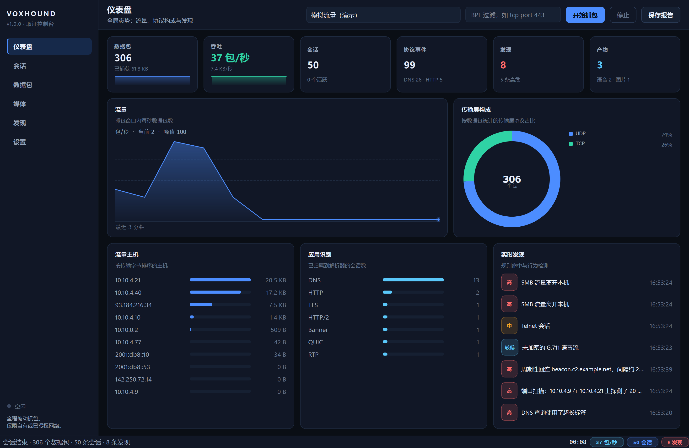
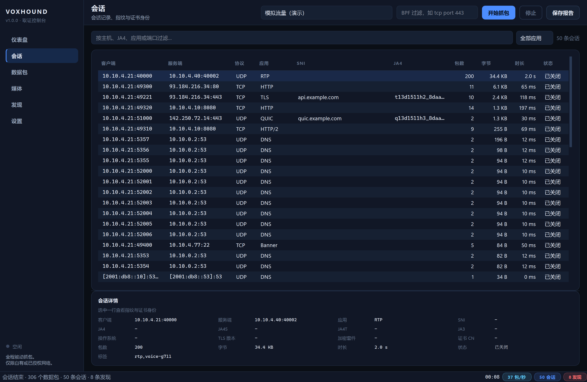
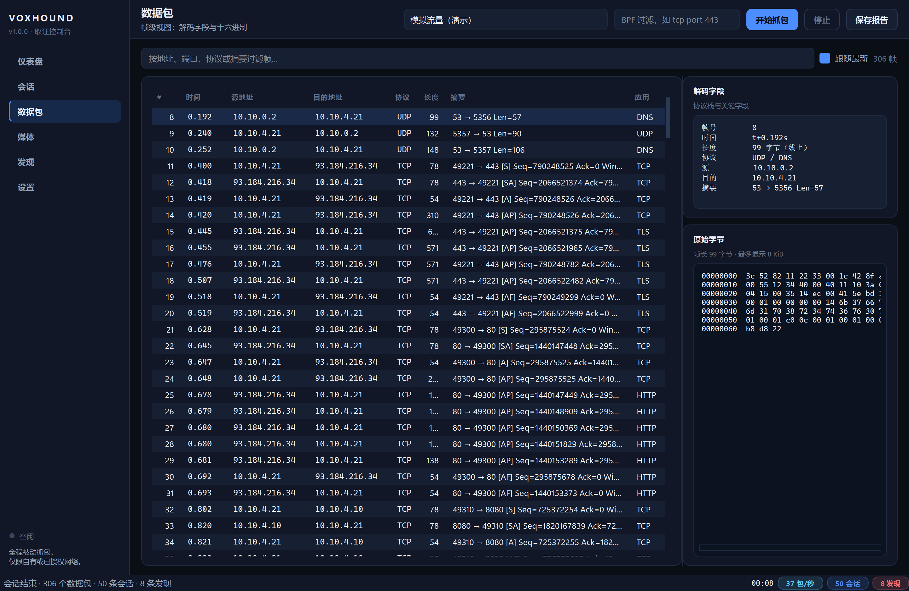
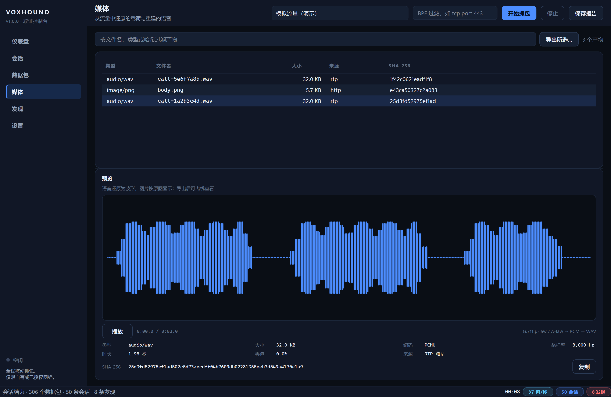
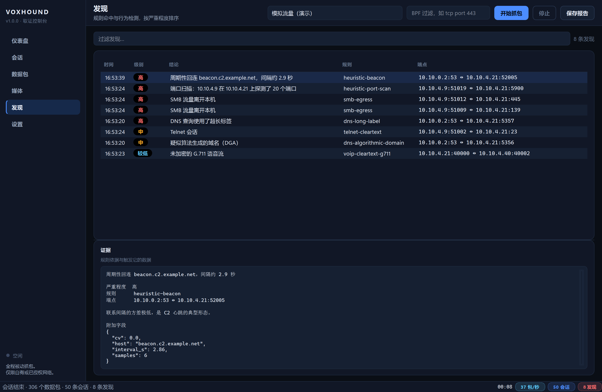
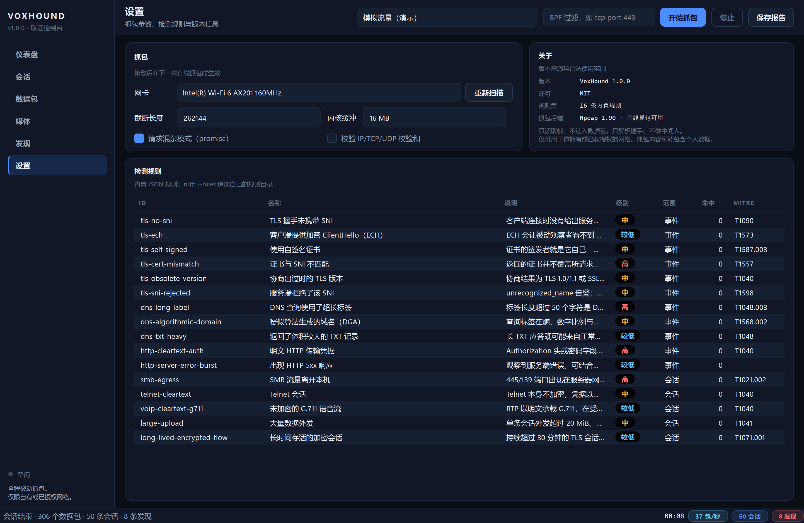
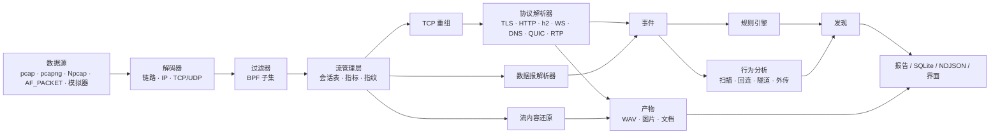

# VoxHound

面向语音与媒体流量的被动网络取证工作台。输入是一个抓包文件或一块在线网卡，输出是会话表、协议指纹、资产清单和结论。

[](.github/workflows/ci.yml)
[](LICENSE)
[](pyproject.toml)
[](#为什么坚持零依赖引擎)



英文文档见 [`README.en.md`](README.en.md) 与 `docs/*.en.md`，中文为主版本。

## 它解决什么问题

读包、拼流，然后回答分析人员关心的问题：

- 谁在和谁通信？会话表给出 SNI、ALPN、证书身份、HTTP Host、DNS 名，以及 JA3 / JA4 / JA4S / JA4T 指纹和操作系统提示。
- 说了什么？RTP/RTCP 按 SSRC 重组，G.711（µ-law/A-law）解码成可直接播放的 WAV，应用内可试听；Opus 一类导出原始载荷与时间信息。解不了的编码如实说明，不假装能解。
- 加密流量里有什么？QUIC Initial 包会被解密（RFC 9001 由连接 ID 推导的公开密钥，不需要密钥材料，也不做中间人），从中取出 TLS ClientHello，得到 SNI 与 JA4Q。
- 哪些值得追？16 条声明式规则加四类行为检测（端口扫描、周期回连、DNS 隧道、数据外传），每条结论都附带证据。

输出可以是单文件 HTML 报告、SQLite 数据库、NDJSON、CSV、过滤后的 pcap，或者直接在桌面端里看。

| | |
|---|---|
|  |  |
| 会话：记录、指纹、证书身份 | 数据包：帧列表、解码字段、十六进制 |
|  |  |
| 媒体：载荷还原、语音重建 | 发现：规则命中与行为检测 |
|  | |
| 设置：抓包参数、检测规则与合法使用边界 | |

## 为什么坚持零依赖引擎

`pip install voxhound` 不拉任何第三方包。没有 Scapy、dpkt、cryptography 或 pyshark，引擎只 import 标准库：

| 层 | 依赖 | 意义 |
|---|---|---|
| `capture` / `decode` / `app` / `flows` / `media` / `rules` | 仅标准库 | 能在 CI、容器、隔离网主机、裸解释器上跑；测试不需要 mock |
| `crypto` | 标准库（纯 Python AES-GCM、HKDF） | 解 QUIC Initial 不必编译，也不必赌 OpenSSL 版本 |
| `ui` | `PySide6`（可选 extra） | 桌面壳是唯一可选部分 |

理由不是洁癖。出事的那台机器往往装不了依赖，取证工具恰好在那种机器上最有用。CI 用 AST 静态检查守住这条线：`voxhound/` 除 `ui/` 外一旦 import 第三方模块即失败。

## 安装

```bash
git clone https://github.com/nebula-eng/voxhound.git
cd voxhound
python -m pip install -e ".[gui]"     # 只要引擎：pip install -e .
voxhound-gui                           # 或：voxhound gui
```

在线抓包需要驱动，离线分析不需要：

| 平台 | 依赖 |
|---|---|
| Windows | [Npcap](https://npcap.com/#download)，安装时勾选 WinPcap API-compatible Mode |
| Linux | `libpcap`（`apt install libpcap0.8`），或用 `CAP_NET_RAW` 配合 `--raw-socket`（纯 AF_PACKET，不需要 libpcap） |
| macOS | 系统自带 libpcap |

`voxhound interfaces` 会直接告诉你当前可用什么、缺什么。

## 快速开始

```bash
# 1. 不需要任何权限，先看它怎么工作：完整模拟会话
voxhound demo --report demo.html --artifacts out/

# 2. 取证分析
voxhound analyze capture.pcapng --report report.html --store session.db --artifacts carved/

# 3. 在线抓包 + 内核过滤 + 同时落盘
sudo voxhound sniff -i eth0 --filter "udp or tcp port 443" -w live.pcap --duration 60

# 4. 先从大文件里切出 TLS 会话，再单独分析
voxhound extract capture.pcap -o tls.pcap --filter "tcp port 443"
voxhound analyze tls.pcap --filter "tls" --report tls.html
```

退出码可直接接 CI：`0` 无高危发现、`1` 存在高危、`2` 存在严重、`3` 参数或数据源错误。

### 桌面端

`voxhound-gui` 打开六页控制台：仪表盘、会话、数据包、媒体、发现、设置。`Ctrl+1…6` 切页，`Ctrl+R` 启停，`Ctrl+S` 保存报告。内置「模拟流量（演示）」数据源，没有任何抓包权限也能跑出完整会话，演示、评审、回归都靠它。

Windows 日常启动：双击仓库根目录的 `VoxHound.cmd`；把 `.pcap/.pcapng/.cap/.gz` 拖到它上面会直接打开并分析该文件。脚本优先使用项目内的 `.venv`，没有则回退到 PATH 中能导入本项目的 Python。首次使用可执行：

```bash
python -m venv .venv
.venv\Scripts\python -m pip install -e ".[gui]"
```

等价的命令行方式：

```bash
python -m voxhound gui                  # 打开界面（默认演示源）
python -m voxhound gui capture.pcapng   # 打开文件并自动分析
python -m voxhound gui iface:eth0       # 预选网卡，点「开始抓包」
```

若 `voxhound` / `voxhound-gui` 提示找不到命令，说明 Python 的 `Scripts` 目录不在 PATH，用 `python -m voxhound` 即可，不依赖 PATH。

## 解析了什么

| 层次 | 协议 | 说明 |
|---|---|---|
| 链路 | 以太网、802.1Q/802.1ad、MPLS、PPPoE、802.3 LLC/SNAP、Linux SLL/SLL2、BSD loopback、裸 IP | 多层 VLAN 标签保留 |
| 网络 | IPv4（含选项、分片重组）、IPv6（扩展头链、分片重组）、ARP、ICMP、ICMPv6 | 可选校验和验证 |
| 传输 | TCP（完整选项、乱序重组、重传/重复统计、空洞检测、32 位序号回绕）、UDP、SCTP/GRE/ESP 透传 | 重叠数据先到先得 |
| 应用 | TLS 1.2/1.3（SNI、ALPN、版本、套件、证书链与 X.509 身份、JA3/JA4/JA4S）、HTTP/1.1（chunked、流水线、正文还原）、HTTP/2（HPACK + Huffman）、WebSocket、DNS（压缩指针、EDNS、DGA 打分）、QUIC（Initial 解密、JA4Q）、RTP/RTCP（抖动、丢包、音频）、SIP/SDP、STUN、MQTT、横幅类协议（SSH/FTP/SMTP/Redis/RTMP 等） | 分流先看内容特征，端口只作兜底 |

完整矩阵与边界见 [`docs/PROTOCOLS.md`](docs/PROTOCOLS.md)。

## 架构



引擎单线程、同步；桌面端把它放到工作线程，用 Qt 信号按批回传（48 个包或 120 毫秒一批）。内存处处有界：包环 20 000 行、会话表 LRU 120 000、乱序缓冲 8 MiB/方向、流预览 64 KiB、产物预算 256 MiB、分片表 4 096 条。

设计约束与关键算法（重组、JA4、QUIC 解密、HPACK）见 [`docs/ARCHITECTURE.md`](docs/ARCHITECTURE.md)。

## 检测

内置 16 条规则（[`voxhound/rules/builtin.json`](voxhound/rules/builtin.json)）：无 SNI 的 TLS、ECH、自签或证书不匹配、过时 TLS、超长 DNS 标签、DGA 域名、明文凭据、SMB 外联、明文 G.711、长时间加密会话等。自定义规则就是一个 JSON：

```json
{
  "id": "corp-dns-allowlist",
  "name": "查询绕过了企业 DNS",
  "severity": 2,
  "scope": "flow",
  "match": { "proto": "UDP", "port": 53, "ip_regex": "^10\\.10\\.0\\.2$" }
}
```

规则语法见 [`docs/RULES.md`](docs/RULES.md)。

四类行为检测保持可解释：

| 检测 | 判据 |
|---|---|
| 端口扫描 | 单一源在短窗口内触达 N 个不同目的端口 |
| 周期回连 | 联系间隔的变异系数（与周期长度无关，5 秒与 5 小时的植入体同样命中） |
| DNS 隧道 | 同一父域下高基数子域 |
| 数据外传 | 单向流量显著偏斜且超过体积下限 |

## 明确的边界

- 纯被动。不注入、不 ARP 欺骗、不做 TLS 中间人、不绕过证书固定。
- 加密载荷保持加密，仅两个例外：QUIC Initial（密钥按协议本就公开）与明文协议自身暴露的内容。
- 不做 GeoIP / ASN / 信誉查询。所有结论都由抓包字节算出，离线可复现；情报丰富化应放在你的流水线里，而不是取证工具的热路径上。
- 纯 Python 加密很慢。QUIC 解密有每流上限（6 个 Initial / 8 KiB），它是握手读取器，不是批量解密机。
- 不做 802.11 radiotap 解析，监听模式 Wi-Fi 分析不在范围内。
- 一个实例一次抓包，多网卡合并仍在路线图里。

## 合法使用

本工具分析的是网络流量，而流量里是别人的数据。

请仅在你拥有、或已获得书面授权的网络中使用，并遵守当地法律。抓到的载荷可能包含个人数据、凭据与第三方内容，按你的留存策略保管，且不要执行还原出来的文件。

工具在设计上不具备中间人能力：它只读，不注入。

## 开发

```bash
python -m pip install -e ".[dev]"
python -m pytest -q                 # 82 个测试，只用引擎，不需要 Qt
python -m ruff check voxhound tests
python scripts/screenshot.py docs/screenshots    # 重新生成 README 截图
python scripts/gen_hpack_huffman.py              # 从 RFC 7541 重建 HPACK 表
```

提 PR 前请读 [`CONTRIBUTING.md`](CONTRIBUTING.md)：不加运行时依赖、内存必须有界、`Packet` 不得带着 `memoryview` 逃逸出解码阶段等硬性约定。

## 目录

| 路径 | 内容 |
|---|---|
| [`docs/ARCHITECTURE.md`](docs/ARCHITECTURE.md) | 分层、不变式、重组算法、QUIC 解密、HPACK、线程模型 |
| [`docs/PROTOCOLS.md`](docs/PROTOCOLS.md) | 协议支持矩阵与已知边界 |
| [`docs/RULES.md`](docs/RULES.md) | 规则 DSL 与示例 |
| [`docs/CLI.md`](docs/CLI.md) | 命令行、过滤器语法、退出码 |
| [`docs/sample-report.html`](docs/sample-report.html) | 由演示流量生成的真实报告样例 |
| [`CHANGELOG.md`](CHANGELOG.md) | 版本变更记录 |

## 路线图

- [ ] 从 `SSLKEYLOGFILE` 解密 TLS 1.3（引擎管线已就绪，缺测试向量）
- [ ] 多网卡合并抓包与时间对齐
- [ ] JA4X（证书指纹）与 JA4H（HTTP 客户端指纹）
- [ ] 导出 Arkime / Zeek 友好格式
- [ ] 规则目录热加载
- [ ] Linux `AF_XDP` 快路径

## 许可证

MIT，见 [`LICENSE`](LICENSE)。安全问题请按 [`SECURITY.md`](SECURITY.md) 的方式私下报告。
